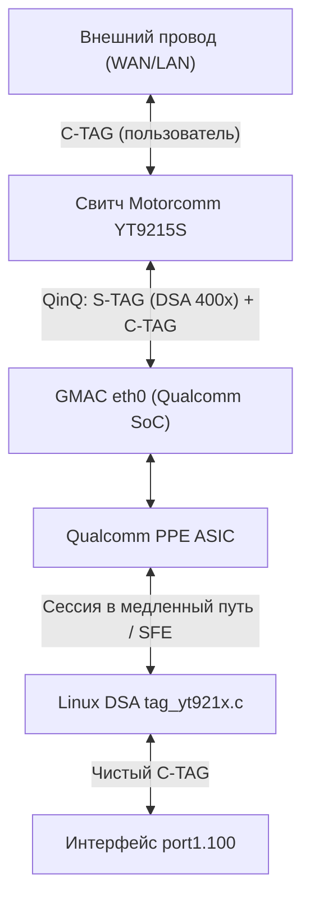

# Перспективная архитектура QinQ (IEEE 802.1ad) для пользовательских VLAN поверх открытого DSA

**Маршрутизаторы:** Xiaomi Router BE3600 (RD15 / RD16)  
**Процессор:** Qualcomm IPQ5332 (4x Cortex-A7 @ 1.1 GHz)  
**Свитч:** Motorcomm YT9215S (5-портовый GE L2 Smart Switch)  
**Ядро:** Linux 5.4.213 (Qualcomm QSDK 12.5)  
**Подсистемы оффлоада:** Qualcomm PPE (Packet Processing Engine) + ECM (Enhanced Connection Manager)  
**Базовый механизм DSA:** Маскировка под IEEE 802.1Q VLAN (`DSA_YT921X_VID_BASE = 4000`, диапазон 4001..4004)  
**Статус документа:** Перспективная доработка / Архитектурный план расширения драйвера `kmod-yt-921x-dsa`  

---

## 1. Архитектурная проблема и постановка задачи

В текущей рабочей архитектуре DSA-драйвера (`kmod-yt-921x-dsa`) физические порты коммутатора (`port1`..`port4`) маскируются под виртуальные 802.1Q VLAN на мастер-интерфейсе `eth0`:
* Свитч Motorcomm YT9215S на RGMII-аплинк шине к `eth0` помечает кадры каждого порта изолированным системным тегом:
  * Port 1 (WAN) $\to$ VID `4001`
  * Port 2 (LAN 1) $\to$ VID `4002`
  * Port 3 (LAN 2) $\to$ VID `4003`
  * Port 0 (LAN 4 на RD16) $\to$ VID `4004`
* Модули `nss_ppe_vlan_mgr` и `ecm_interface` регистрируют DSA slave устройства как VLAN-интерфейсы на `eth0`.

**Постановка задачи:** Обеспечить поддержку пользовательских VLAN поверх портов маршрутизатора с сохранением аппаратного ускорения Qualcomm PPE:
1. **Провайдерский WAN VLAN (802.1Q sub-interface):**
   * Подключение к интернету через тегированный интерфейс (например, `port1.100` для Интернета и `port1.200` для IPTV).
2. **Изолированные сети в LAN (Bridge VLAN Filtering):**
   * Разделение локальных портов через мост `br-lan` с включенным `vlan_filtering=1`:
     * VLAN 10 — Домашняя доверенная сеть (LAN 1, Wi-Fi 5G).
     * VLAN 20 — Изолированная сеть IoT / Умный дом (LAN 2, Wi-Fi 2.4G).
     * VLAN 30 — Гостевая сеть.
3. **802.1Q Trunk на внешний управляемый коммутатор / AP:**
   * Передача нескольких тегированных VLAN через один физический медный порт роутера.

Если на аплинк-шине к процессору уже используется 802.1Q тег для разделения портов, требуется разграничить служебный тег порта свитча и пользовательский VLAN клиента без потери кремниевого ускорения PPE.

---

## 2. Модель двойного тегирования (QinQ / 802.1ad)

Стандартизированным решением этой задачи является **двойное тегирование IEEE 802.1ad (QinQ / VLAN Stacking)**.

В этой модели кадр содержит два уровня заголовков 802.1Q:
* **S-TAG (Service Tag / Внешний тег):**
  * Используется исключительно для служебных нужд DSA на шине `eth0`.
  * Несет аппаратный индекс порта свитча: `VID 4001..4004`.
  * Аппаратно изолирован и не выходит на внешние медные разъемы роутера.
* **C-TAG (Customer Tag / Внутренний тег):**
  * Несет пользовательский VLAN: `VID 100`, `VID 20` и т.д.
  * Формируется клиентом, провайдером или локальным интерфейсом Linux `portX.Y`.

```
Кадр на внешнем медном порту (кабель к клиенту/провайдеру):
┌──────────────┬──────────────────┬─────────────────┬───────────┐
│ DMAC + SMAC  │ C-TAG (VID 100)  │ EtherType / IP  │ Payload   │
└──────────────┴──────────────────┴─────────────────┴───────────┘
               ▲ EtherType 0x8100

Кадр на внутренней шине RGMII/SerDes (eth0 между свитчем и IPQ5332):
┌──────────────┬──────────────────┬──────────────────┬─────────────────┬───────────┐
│ DMAC + SMAC  │ S-TAG (VID 4001) │ C-TAG (VID 100)  │ EtherType / IP  │ Payload   │
└──────────────┴──────────────────┴──────────────────┴─────────────────┴───────────┘
               ▲ EtherType 0x88A8 ▲ EtherType 0x8100
                 (или 0x8100 QinQ)  (пользователь)
                 (служебный DSA)
```

---

## 3. Распределение обязанностей компонентов системы



### 3.1. Коммутатор Motorcomm YT9215S (`yt-921x-dsa`)
Коммутатор выполняет аппаратную инкапсуляцию и декапсуляцию внешнего S-TAG:
1. **Входящий трафик (Ingress с медного порта $\to$ CPU Port 5):**
   * На медный порт `Port 1` приходит кадр с пользовательским тегом `C-TAG: 100`.
   * Свитч по правилу PVID порта накладывает **внешний S-TAG `4001`**.
   * Исходный пользовательский `C-TAG: 100` сдвигается вглубь заголовка (inner tag).
   * Если с медного порта пришел нетегированный кадр: накладывается только `S-TAG: 4001` (одиночный тег).
2. **Исходящий трафик (Egress с CPU Port 5 $\to$ медный порт):**
   * Из процессора или PPE в свитч поступает кадр с внешним `S-TAG: 4001` и внутренним `C-TAG: 100`.
   * Свитч по внешнему тегу `4001` направляет кадр в медный порт `Port 1`.
   * На порту `Port 1` включен режим **Egress Untagged для S-TAG**: свитч **срезает внешний тег `4001`**.
   * В медный кабель передается кадр с оригинальным пользовательским `C-TAG: 100`.

### 3.2. Аппаратный кремниевый акселератор Qualcomm PPE
Блок PPE в SoC IPQ5332 содержит двухуровневый аппаратный парсер VLAN и две таблицы трансляции тегов: `EG_VLAN_XLT_0` и `EG_VLAN_XLT_1`.
1. **Разбор входящего кадра (Ingress Parsing):**
   * PPE считывает `S-TAG (4001)` $\to$ идентифицирует базовый виртуальный порт источника (`port1`).
   * PPE считывает `C-TAG (100)` $\to$ определяет пользовательский интерфейс (`port1.100`).
   * По кортежу `{IP_SRC, IP_DST, PORT_SRC, PORT_DST, PROTO, SVID=4001, CVID=100}` выполняется поиск сессии в Flow Table.
2. **Аппаратная модификация на выходе (Egress Rewriting):**
   * Если сессия направлена в локальную сеть `br-lan` на медный порт `Port 2` (без VLAN):
     * PPE срезает внутренний `C-TAG: 100`.
     * PPE заменяет внешний `S-TAG: 4001` на `S-TAG: 4002`.
     * Пакет вылетает в свитч $\to$ свитч срезает `4002` $\to$ клиент LAN получает нетегированный пакет.
   * Если сессия направлена на интерфейс 2.5G (`port4`) или Wi-Fi (`ath1`):
     * PPE аппаратно срезает **оба тега** (`S-TAG` и `C-TAG`).
     * В контроллер 2.5G PHY или кольцо DMA Wi-Fi передается чистый IP-пакет.

### 3.3. Менеджер VLAN PPE (`qca-nss-ppe-vlan`)
Патч поддержки DSA расширяется для обработки вложенных VLAN:
```c
/*
 * Определение типа интерфейса в nss_ppe_vlan_mgr.c
 */
if (is_vlan_dev(dev)) {
    real_dev = vlan_dev_priv(dev)->real_dev;
    
    /* Сценарий: port1.100 (VLAN поверх DSA) */
    if (dsa_slave_dev_check(real_dev)) {
        master_dev = dsa_slave_to_master(real_dev); /* eth0 */
        stag_vid = dsa_slave_to_vid(real_dev);      /* 4001 */
        ctag_vid = vlan_dev_priv(dev)->vlan_id;     /* 100 */
        
        /* Регистрация двухуровневого правила QinQ в PPE */
        ppe_drv_vlan_add_qinq_rule(master_dev, stag_vid, ctag_vid);
    }
}
```

### 3.4. Менеджер соединений ECM (`qca-nss-ecm`)
В `ecm_interface.c` формируется 3-уровневая иерархия устройств:
```text
[Уровень 2]: port1.100 (Type: ECM_DB_IFACE_TYPE_VLAN, VID: 100, Role: C-TAG)
     │
[Уровень 1]: port1     (Type: ECM_DB_IFACE_TYPE_VLAN, VID: 4001, Role: S-TAG)
     │
[Уровень 0]: eth0      (Type: ECM_DB_IFACE_TYPE_ETHERNET, GMAC1 physical)
```
При формировании правила для PPE фронтенд ECM передает дескрипторы:
* `fal_nh.stag_fmt = 1; fal_nh.svid = 4001;` (индекс порта для свитча).
* `fal_nh.ctag_fmt = 1; fal_nh.cvid = 100;` (клиентский VLAN).

---

## 4. Сценарии движения пакетов (Packet Walks)

### Сценарий А: Провайдерский WAN с VLAN 100 $\to$ Домашний LAN (Untagged)
```
[Интернет] 
   │ 802.1Q (VID 100)
   ▼
[Port 1 (WAN) на свитче Motorcomm]
   │ Свитч добавляет внешний S-TAG 4001 (PVID порта)
   ▼
[RGMII eth0]: DMAC | S-TAG 4001 | C-TAG 100 | IP | TCP
   │
   ▼
[Qualcomm PPE Core]:
   │ 1. Match: Ingress eth0, S-VID=4001, C-VID=100.
   │ 2. NAT: подмена внешнего IP на локальный 192.168.1.15.
   │ 3. Route: выходной интерфейс — Port 2 (LAN).
   │ 4. Vlan Action: срезать C-TAG 100, заменить S-TAG 4001 на 4002.
   ▼
[RGMII eth0]: DMAC | S-TAG 4002 | IP | TCP
   │
   ▼
[Port 2 на свитче Motorcomm]:
   │ Свитч считывает S-TAG 4002 -> направляет в Port 2 -> срезает S-TAG 4002
   ▼
[ПК Клиента в LAN 2]: Нетегированный Ethernet-кадр
```

### Сценарий Б: Локальный мост Bridge VLAN Filtering (Тэг 20 на Port 2 $\to$ Тэг 20 на Port 3)
1. **Ingress на Port 2:**
   * Кадр поступает с клиентским тегом `C-TAG: 20`.
   * Свитч накладывает `S-TAG: 4002` и передает в CPU `eth0`.
2. **PPE Switching / L2 Flow:**
   * PPE сопоставляет источник `Port 2 (S-TAG 4002)` и пользовательский VLAN `20`.
   * Мост `br-lan` разрешает форвардинг VLAN 20 в `Port 3`.
   * Действие PPE: заменить `S-TAG 4002` на `S-TAG 4003`, сохранив `C-TAG 20` нетронутым.
3. **Egress на Port 3:**
   * Свитч получает кадр с `S-TAG: 4003` и `C-TAG: 20`.
   * Свитч срезает служебный `S-TAG: 4003`.
   * В кабель к внешнему устройству уходит кадр с сохраненным `C-TAG: 20`.

---

## 5. Защита от коллизий и граничные случаи

| Потенциальная ситуация | Механизм защиты |
| :--- | :--- |
| **Пользователь создал `port1.4001` (VID совпал со служебным)** | Конфликта нет: служебный тег находится на позиции **S-TAG**, а пользовательский — на позиции **C-TAG**. Для аппаратного парсера это разные смещения заголовка. |
| **Провайдер шлет нетегированный трафик на `port1`** | Пакет содержит только одиночный `S-TAG: 4001`. PPE обрабатывает его как одиночный VLAN (C-TAG отсутствует, `ctag_fmt = 0`). |
| **MTU и оверхед двойного тега (+8 байт)** | На интерфейсе `eth0` MTU устанавливается в `1508` байт (1500 данных + 4 байта C-TAG + 4 байта S-TAG), исключая фрагментацию кадров. |
| **SFE Fast-Path (программный путь)** | Хук `tag_yt921x.c` на CPU срезает внешний `S-TAG 4001`, оставляет внутренний `C-TAG 100` в `skb` и передает его в `netif_receive_skb`. SFE ускоряет сессию по интерфейсу `port1.100`. |

---

## 6. План необходимых доработок в кодовой базе

Для включения аппаратной поддержки QinQ поверх существующего DSA-драйвера требуется:
1. **Драйвер свитча `yt-921x-dsa` (`yt921x.c` / `tag_yt921x.c`)**:
   * Включить бит поддержки QinQ в регистрах порта CPU (Port 5) для пропуска кадров с двойным тегом.
   * Настроить TPID распознавания: `0x88A8` для S-TAG (или двойной `0x8100`).
2. **Патч `0002-vlan-mgr-support-dsa-slave-ports.patch` (`qca-nss-ppe-vlan`)**:
   * Добавить проверку `is_vlan_dev(dev) && dsa_slave_dev_check(vlan_dev_priv(dev)->real_dev)`.
   * Передавать в `ppe_drv` параметры `stag` (база 4000) и `ctag` (пользовательский VID).
3. **Патч `0002-ecm-support-dsa-slave-ports-as-vlan.patch` (`qca-nss-ecm`)**:
   * Разрешить вложенность `ECM_DB_IFACE_TYPE_VLAN` внутри другого `ECM_DB_IFACE_TYPE_VLAN` при условии, что базовый слой является DSA slave портом.
   * Выставлять `ctag_fmt = 1` и `cvid = user_vid` в структуре `ppe_drv_nexthop`.
4. **Конфигурация ядра (`config-5.4`)**:
   * Проверить активность `CONFIG_VLAN_8021Q=y`.
   * Обеспечить поддержку QinQ в nftables/firewall4 (`CONFIG_NETFILTER_XT_MATCH_VLAN`).
